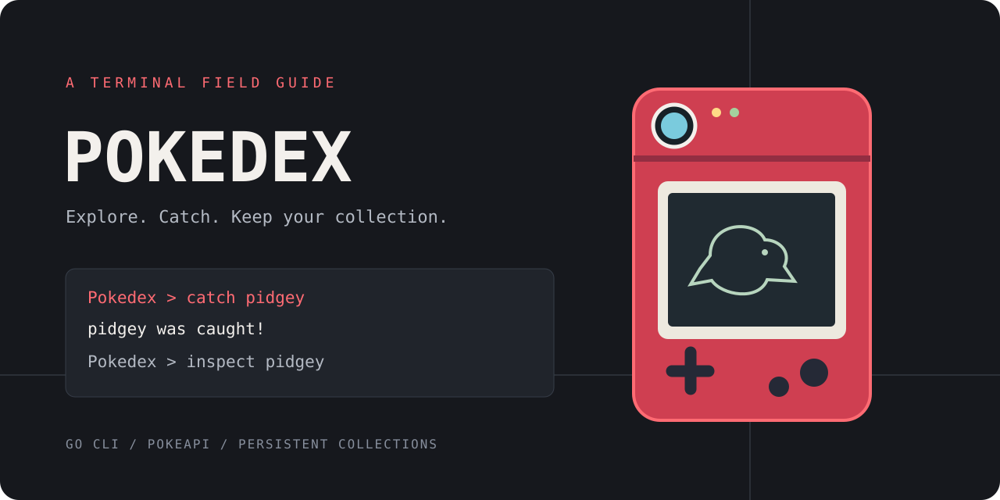

# Pokedex — A Pokemon field guide for your terminal

Explore location areas, catch Pokemon, and inspect the collection you've built.
Pokedex uses PokéAPI for world data and saves caught Pokemon automatically,
so your collection is available when you return. Use the interactive prompt
or run individual commands from your shell.

[Download v1.0.0](https://github.com/yaqyn/pokedex/releases/tag/v1.0.0) or [run from source](#-quick-start). New API data requires an internet connection. No account,
API key, or runtime dependencies are needed for a compiled binary.

##  Features

- Browse location areas in pages of 20 and discover the Pokemon found in each area.
- Catch Pokemon with an experience-based probability, then inspect their stats and types offline.
- Save catches immediately and restore them when you restart, with one writer per collection.
- Run individual commands or pipe batches with failure exit codes for scripts.
- Reuse API responses through a concurrent cache with expiration and memory bounds.
- Handle failed requests, invalid commands, EOF, and interruption without losing previous saves.

##  Installation

Download the archive for your operating system and architecture from the
[release page](https://github.com/yaqyn/pokedex/releases/tag/v1.0.0), verify it against
`SHA256SUMS`, and extract it. Run the included `pokedex` binary (`pokedex.exe` on
Windows). Release archives include the README and dependency notices.

Source builds require the Go version declared in [go.mod](go.mod) or newer.
Go downloads the pinned build dependencies on the first build:

```bash
git clone https://github.com/yaqyn/pokedex.git
cd pokedex
```

Then build from the project root:

```bash
go build -trimpath -o pokedex .
```

On Windows, build with `-o pokedex.exe` and run `./pokedex.exe` in PowerShell.
Collection locking supports Linux, macOS, and Windows.

##  Quick start

```bash
./pokedex
```

At the prompt, enter:

```text
map
explore pastoria-city-area
catch pidgey
inspect pidgey
pokedex
exit
```

A catch can succeed or escape; repeat `catch pidgey` until it succeeds. You should
then see its name, height, weight, stats, and types with `inspect pidgey`.
Restart the CLI to restore the collection. `exit` closes the session; Ctrl+C
also stops it. Use `-ephemeral` when you want a temporary collection.

##  Usage

Use `count` to print the number of distinct caught Pokemon offline. Commands and Pokemon/area names are case-insensitive. Names use letters, digits,
and hyphens. Missing or extra arguments show the command's usage.

| Command | Result |
| --- | --- |
| `help` | List every command and its description |
| `map` | Show the next 20 location areas |
| `mapb` | Show the previous page, or explain that you're on the first page |
| `explore <area>` | List the Pokemon encountered in an area |
| `catch <pokemon>` | Attempt a catch; higher base experience lowers the probability |
| `inspect <pokemon>` | Show details of a Pokemon you've caught |
| `pokedex` | List caught Pokemon in alphabetical order |
| `exit` | Close the session |

Height and weight retain [PokéAPI's units](https://pokeapi.co/docs/v2#pokemon): decimetres and hectograms.
For example, Pidgey's height of `3` means 0.3 metres, and its weight of `18`
means 1.8 kilograms.

Run one command directly or pipe a batch:

```bash
./pokedex inspect pidgey
./pokedex pokedex
printf 'help\npokedex\nexit\n' | ./pokedex
```

Single commands omit the prompt and return a nonzero status on failure. Piped
batches keep processing after command errors, then return a nonzero status if
any command failed. Errors go to stderr; results go to stdout. The interactive
REPL remains usable after errors. A Pokemon escaping is a successful catch
attempt, so it does not produce a failure exit code.

##  Configuration

| Flag | Default | Purpose |
| --- | --- | --- |
| `-data <path>` | Platform user directory | Override the collection file; create parent directories as needed |
| `-ephemeral` | Disabled | Use a temporary collection without reading or writing saves |
| `-timeout <duration>` | `10s` | Bound each API request, e.g. `-timeout 5s` |
| `-version` | — | Print the build version (`dev` for a source build) |
| `-h` | — | Show flags |

Flags precede the command, for example `./pokedex -data ./collection.json pokedex`.
`-data` and `-ephemeral` cannot be combined. The default collection locations are:

- Linux: `$XDG_CONFIG_HOME/pokedex/pokedex.json`, or `~/.config/pokedex/pokedex.json`.
- macOS: `~/Library/Application Support/pokedex/pokedex.json`.
- Windows: `%AppData%\pokedex\pokedex.json`.

Parent directories are created automatically. JSON saves are versioned and
bounded to 4 MiB. New directories and files use owner-only permissions on Unix;
Windows uses the current user's filesystem access controls. A malformed or
unsupported save stops startup and is left untouched. Back up the JSON file
before editing it.

A `.lock` file beside the save coordinates writers. A second session using the
same save fails with a clear error. The operating system releases the lock when
the process exits; the empty lock file can remain. Locks are advisory: other
programs that ignore them can still modify the JSON. Use a local filesystem.

If PokéAPI returns HTTP 404, check the name; HTTP 429 means you should wait before
retrying. Request failures do not advance map pagination or add catches. A save
failure rolls back the new catch in memory so the CLI does not claim it was saved.

##  Architecture

The REPL parses input and dispatches through a shared command registry. Commands
receive a configuration containing the API client, collection, output writer,
random source, and optional save function. Those boundaries allow command tests
to control network responses and catch outcomes.

- [repl.go](repl.go): input normalization, argument validation, and dispatch.
- [commands.go](commands.go): pagination, exploration, catching, and collection display.
- [internal/pokeapi](internal/pokeapi): bounded HTTP requests and typed JSON responses.
- [internal/pokecache](internal/pokecache): synchronized byte cache and expiry worker.
- [storage.go](storage.go): bounded loading and same-directory save replacement.
- [storage_lock.go](storage_lock.go): cross-platform cooperating-writer locks.
- [main.go](main.go): flags, dependency wiring, signal handling, and cleanup.

The cache expires entries after five minutes and stores at most 256 responses or
16 MiB of response bytes, excluding map/key overhead. Cache keys are limited to 4 KiB. Individual API responses are
limited to 4 MiB. Cache reads return copies and reject expired entries immediately.
Only successfully decoded and validated responses are cached.

##  Verification

```bash
go test -race ./...
go vet ./...
go run golang.org/x/vuln/cmd/govulncheck@v1.9.0 ./...
```

Tests cover pagination boundaries, deterministic catch/escape outcomes, offline
inspection, cache reuse and expiration, concurrent access, HTTP failure cases,
timeouts, URL boundaries, invalid identifiers, save round trips, corruption, and
exclusive writer locks, one-shot commands, automatic save directories, and batch error statuses. HTTP tests use local fixtures and do not require PokéAPI.

[CI](.github/workflows/ci.yml) runs tests, vet, and builds on Linux, macOS, and
Windows; its Linux security job checks reachable Go vulnerabilities and formatting.
Local verification also included a live catch/save/restart session against PokéAPI.
Native tests, vet, builds, and the security check have passed in [GitHub Actions](https://github.com/yaqyn/pokedex/actions/workflows/ci.yml).

To create Linux, macOS, and Windows archives for amd64 and arm64:

```bash
python3 scripts/release.py v1.0.0
```

Archives and `SHA256SUMS` appear in `dist/v1.0.0/`. This builds local artifacts and requires a clean Git tree;
it does not publish a release. Python 3 is required only for this packaging step.

##  Security and limitations

- Production requests use HTTPS to a fixed PokéAPI origin. Redirects and pagination
  URLs outside that origin/path are rejected.
- Identifiers and displayed Pokemon fields are validated to reject terminal controls.
- This is a single-user CLI. Saves are flushed before replacement and protected by
  cooperating-writer locks. Unix uses atomic rename; Windows uses replacement moves
  with write-through. This is not a backup or database durability guarantee.
  Collections have no synchronization service or automatic backups.
- Cache entries are session-local. New exploration and catch data depend on PokéAPI
  availability; caught Pokemon can be inspected without network access.
- Command history, battle simulation, and evolution are not implemented.

##  License

The CLI is available under the [MIT license](LICENSE). Dependency licenses are
included in [third-party notices](THIRD_PARTY_NOTICES.md). Pokemon names and game
concepts belong to their respective owners. Data comes from [PokéAPI](https://pokeapi.co/).

> Built from Boot.dev's [Build a Pokedex in Go](https://www.boot.dev/courses/build-pokedex-cli-golang)
> course, extended with automatic persistent saves, single-command and batch use,
> bounded requests and caching, cross-platform locks, cancellation, failure tests,
> and release packaging.
