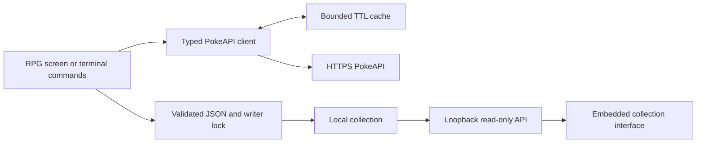

# Architecture

Clibble is one Go binary with two interfaces over the same local collection.
The terminal owns catching and saving; the web companion is an independent,
read-only view. No JavaScript build step or external asset server is required.

## Boundaries

- `main.go`, `identity.go`: flags, modes, dependency wiring, save discovery, and graceful cancellation.
- `repl.go`, `commands.go`: normalized input, command dispatch, pagination, catching, and collection behavior.
- `game.go`, `game_view.go`: Bubble Tea model, asynchronous tasks, keyboard navigation, and alternate-screen rendering.
- `catch.go`: shared catch transaction over a collection snapshot; publish only after save success.
- `presentation.go`, `editor.go`: plain prompt rendering and editing. Script output stays linear and plain.
- `storage*.go`: bounded schema loading, temporary-file replacement, platform replacement methods, and exclusive advisory locks.
- `companion.go`: loopback HTTP server, host/origin validation, read-only JSON, and security headers.
- `internal/webui`: embedded HTML, CSS, JavaScript, mark, and locally licensed font.
- `internal/brand`: canonical identity and palette; `scripts/brand_assets.py` generates adapters.

## Persistence and concurrency

The save format is version 1: a map of canonical Pokemon names and their typed
records. A successful catch is persisted before success is reported. Failed saves
leave the live collection unchanged. A save is at most 4 MiB; malformed data
blocks startup. The CLI holds a writer lock for the session, while the companion
reads snapshots without acquiring the writer lock.

The writer flushes a temporary file before replacement. Unix uses same-directory
rename. Windows uses replacement moves with write-through. Filesystem/network
storage semantics still apply; this is not a backup or power-loss durability guarantee.

## Network and cache

Requests use a fixed production HTTPS origin, cancellation, a default ten-second
timeout, and a 4 MiB response bound. Redirects and pagination outside the configured
origin/path are rejected, including encoded traversal. Responses are decoded and
validated before caching.

The concurrent cache copies bytes on add/read, checks expiry during reads, and
reaps expired entries in a stoppable worker. It stores at most 256 entries or
16 MiB of response bytes, with keys bounded to 4 KiB. The five-minute TTL and worker
lifetime are configured once per command/session.

## Web interaction

The server serves only embedded public assets and the saved collection endpoint.
It rejects foreign Host/Origin values, all write methods, and external content via
CSP. The client filters locally without per-keystroke network requests. Refresh
uses cancellation/timeouts and retains its prior readable state on failure.
Names enter the DOM through textContent, never HTML interpolation.

Go tests verify HTTP/save boundaries. Development-only DOM tests exercise search,
selection, clear/focus, empty states, and failed refresh. These tests do not replace
real-browser layout, keyboard, or accessibility verification.

## Screen state and shutdown

The RPG model owns menu selection, session location, and narration. Network work
returns typed messages with request IDs; cancelled or stale responses cannot
replace the current screen. Workers use collection snapshots and do not mutate
the live model. Catch/save uses the same transaction as command mode. Keyboard
input cannot start a second catch while one is running.

Tasks start before their receive command is returned, and are tracked independently
of the renderer. On exit the task context is cancelled and workers are drained
before `runGame` returns, so the outer save-lock defer cannot run while a save is
still active. Bubble Tea owns terminal mode, cursor, resize events, and alternate
screen restoration. `-plain`, non-TTY input/output, or `TERM=dumb` bypasses the screen.
