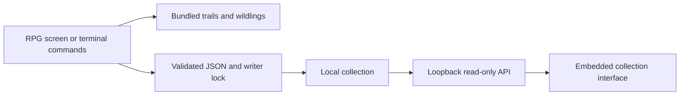

# Architecture

Clibble is one Go binary with two interfaces over the same local collection.
The terminal owns catching and saving; the web companion is an independent,
read-only view. No JavaScript build step or external asset server is required.

## Boundaries

- `main.go`, `identity.go`: flags, modes, dependency wiring, save discovery, and graceful cancellation.
- `repl.go`, `commands.go`: normalized input, command dispatch, pagination, catching, and collection behavior.
- `game.go`, `game_view.go`: Bubble Tea model, asynchronous tasks, keyboard navigation, and alternate-screen rendering.
- `catch.go`: shared catch transaction over a collection snapshot; publish only after save success.
- `presentation.go`, `editor.go`: plain prompt rendering and editing. Script output stays linear and plain.
- `storage*.go`: bounded schema loading, temporary-file replacement, platform replacement methods, and exclusive advisory locks.
- `companion.go`: loopback HTTP server, host/origin validation, read-only JSON, and security headers.
- `internal/webui`: embedded HTML, CSS, JavaScript, mark, and locally licensed font.
- `internal/brand`: canonical identity and palette; `scripts/brand_assets.py` generates adapters.

## Persistence and concurrency

New writes use version 2: the journal plus catch seeds, refill timestamp,
per-wildling encounter budgets, and motion preference. Version-1 collections remain
readable, including imported records. First write upgrades the complete snapshot
atomically; startup never silently resets malformed saves.

`catch.go` resolves offers against a snapshot. Successful catches and escapes both
persist supply and attempt changes before publishing the result. Failed writes
leave the entire live game unchanged. `progress.go` owns the 12-seed capacity,
five-minute regeneration, and three-try / 30-minute species window. The same
transaction serves command and RPG modes, guarded by the existing writer lock.
The companion reads either schema without acquiring the writer lock. Saves remain
bounded to 4 MiB. Local files and time are trusted; these limits discourage ordinary
spamming rather than preventing a device owner from modifying their own game.

The writer flushes a temporary file before replacement. Unix uses same-directory
rename. Windows uses replacement moves with write-through. Filesystem/network
storage semantics still apply; this is not a backup or power-loss durability guarantee.

## Original offline world

`world.go` bundles six trails and ten authored wildlings. It implements the existing
world interface without network requests, background workers, or a runtime data
download. Shyness maps onto the existing catch probability. The legacy record
shape and internal `pokeapi` types are retained as a compatibility adapter for old
saves and the companion JSON. The old HTTP client/cache remain tested migration
code; production startup does not construct or use either. `-timeout` is accepted
for script compatibility and has no effect on offline play.

## Forest renderer

`forest.go` caches a terminal-sized base scene until resize. A half-block glyph
encodes two vertical color samples per terminal cell. Rain, canopy shimmer, and
motes use deterministic frame arithmetic, independent from gameplay RNG. Opaque
central panels and narration replace background cells, so scenery cannot hide
text. Palette tokens come from `internal/brand/identity.json`.

Bubble Tea schedules 12 ticks per second only while focused, colored, and motion
is enabled. One timer chain is active at a time. `NO_COLOR` has a static character
fallback; `-no-motion` overrides the saved preference for the session. No graphics
protocol, external renderer, or image asset is needed. Output is bounded to
320 columns by 120 rows; the minimum interactive screen is 40 by 18.

## Web interaction

The server serves only embedded public assets and the saved collection endpoint.
It rejects foreign Host/Origin values, all write methods, and external content via
CSP. The client filters locally without per-keystroke network requests. Refresh
uses cancellation/timeouts and retains its prior readable state on failure.
Names enter the DOM through textContent, never HTML interpolation.

Go tests verify HTTP/save boundaries. Development-only DOM tests exercise search,
selection, clear/focus, empty states, and failed refresh. These tests do not replace
real-browser layout, keyboard, or accessibility verification.

## Screen state and shutdown

The RPG model owns menu selection, session location, and narration. Background work
returns typed messages with request IDs; cancelled or stale responses cannot
replace the current screen. Workers use collection snapshots and do not mutate
the live model. Catch/save uses the same transaction as command mode. Keyboard
input cannot start a second catch while one is running.

Tasks start before their receive command is returned, and are tracked independently
of the renderer. On exit the task context is cancelled and workers are drained
before `runGame` returns, so the outer save-lock defer cannot run while a save is
still active. Bubble Tea owns terminal mode, cursor, resize events, and alternate
screen restoration. `-plain`, non-TTY input/output, or `TERM=dumb` bypasses the screen.
